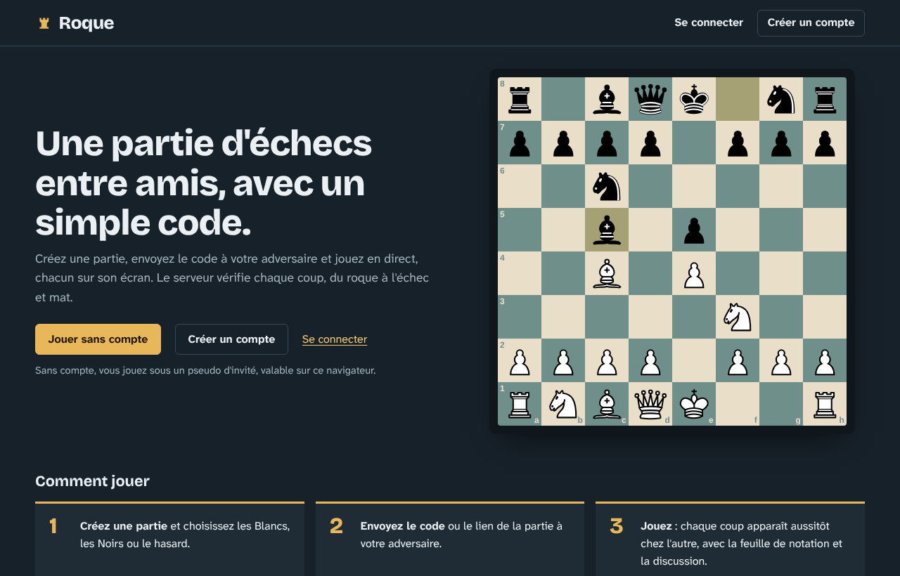
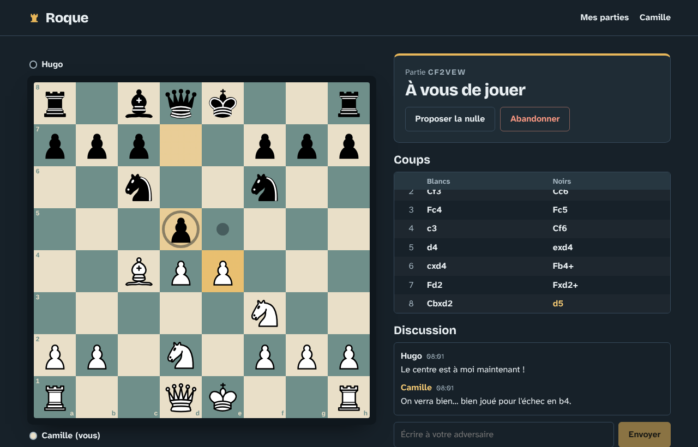
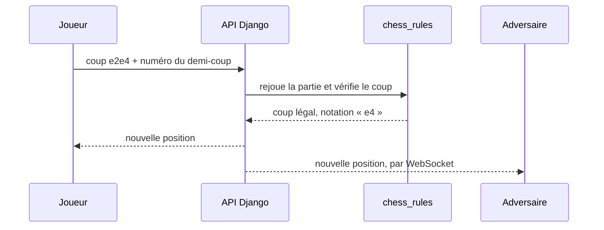

# Roque, échecs en ligne entre amis

Jeu d'échecs en ligne à deux joueurs : on crée une partie, on envoie le code à son adversaire, et chaque coup s'affiche aussitôt chez l'autre. Le serveur Django vérifie chaque coup avec un moteur de règles écrit pour le projet, et l'interface est en Vue 3.

Projet de licence professionnelle DLWM réalisé en binôme avec [Théo Defossez](https://github.com/PendrePilm) : Théo s'occupait du serveur Django, et moi de l'interface Vue et de la logique de jeu. Je l'ai ensuite réécrit, parce que la première version ne permettait pas vraiment de jouer en ligne.

Pour essayer la [démo en ligne](https://echecs-vue-django.onrender.com) : cliquer sur « Jouer sans compte », créer une partie, puis ouvrir son lien dans une fenêtre de navigation privée pour jouer l'adversaire. Elle est hébergée gratuitement sur Render : le premier chargement peut prendre une minute, et les parties sont effacées quand le serveur se met en veille.

<table>
  <tr>
    <td></td>
    <td></td>
  </tr>
</table>

## Fonctionnalités

- Parties par code de 6 caractères ou par lien, en choisissant les Blancs, les Noirs ou le hasard.
- Coups, messages et propositions de nulle reçus en temps réel par WebSocket, avec reconnexion automatique.
- Toutes les règles : roque, prise en passant, promotion, échec et mat, pat, triple répétition, règle des cinquante coups, matériel insuffisant.
- Échiquier jouable à la souris, au doigt ou au clavier, feuille de notation en notation française, discussion, abandon et nulle.
- Comptes avec historique des parties, ou jeu sans compte avec un pseudo d'invité.

**Stack** : Python 3.12, Django 5.2, Django Channels et Daphne (WebSocket), SQLite, Vue 3 et Vite, pytest et Vitest, Docker.

## Fonctionnement

Le navigateur envoie chaque coup à l'API, jamais par le WebSocket. Celui-ci sert seulement à prévenir les deux joueurs qu'il y a du nouveau.



Le coup est enregistré dans une transaction qui relit la partie et vérifie le joueur et son tour. Le numéro du demi-coup évite qu'un double clic ou un coup joué sur une position dépassée soit compté deux fois.

Les règles (`backend/chess_rules`) sont écrites en Python pur, sans dépendance. Le générateur de coups est testé sur les positions de référence (perft) publiées par le [Chess Programming Wiki](https://www.chessprogramming.org/Perft_Results).

## Ce que j'ai corrigé

La première version, rendue en mars 2025 sous le nom « Chess Game », se trouve dans le premier commit, reprise du [dépôt d'origine](https://github.com/PendrePilm/chess2).

- **Pas de jeu en réseau** : chaque joueur jouait sur son propre échiquier, et les coups n'étaient jamais envoyés au serveur.
- **Règles fausses** : le fou et la dame traversaient les pièces, on pouvait laisser son roi en échec, et le roque, la prise en passant et la promotion n'existaient pas.
- **Prise de contrôle de compte** : l'API changeait le mot de passe de n'importe quel compte à partir de son adresse email, sans être connecté.
- **Configuration** : protection CSRF désactivée sur toutes les vues, clé secrète versionnée, mode débogage activé, et la base SQLite avec ses comptes publiée dans le dépôt.

## Sécurité

- C'est le serveur qui décide : seulement des coups légaux, à son tour, avec ses pièces. Seuls les deux joueurs voient une partie et sa discussion.
- Le WebSocket n'accepte que les deux joueurs, vérifie que la page vient du site (en-tête `Origin`) et ne reçoit aucune action.
- Jeton CSRF obligatoire, mots de passe hachés par Django (PBKDF2), connexion bloquée 15 minutes après 5 échecs, session renouvelée à la connexion.
- Vue échappe tout ce qu'il affiche et le projet n'utilise jamais `v-html`. CSP stricte et en-têtes de sécurité.
- Limites de débit sur la discussion (5 messages par 10 secondes) et sur la création de comptes invités.

## Installation

Prérequis : Python 3.12 ou plus récent et Node.js 20 ou plus récent.

```bash
git clone https://github.com/MiscuitAtlas/echecs-vue-django.git
cd echecs-vue-django/backend
python -m venv .venv
source .venv/bin/activate        # Windows : .venv\Scripts\activate
pip install -r requirements-dev.txt
python manage.py migrate
python manage.py runserver       # API et WebSocket sur le port 8000
```

Dans un second terminal :

```bash
cd echecs-vue-django/frontend
npm install
npm run dev                      # http://localhost:5173
```

Ou avec Docker :

```bash
docker build -t echecs .
docker run --rm -p 8000:10000 -e DJANGO_SECRET_KEY="une longue clé aléatoire" -e DJANGO_ALLOWED_HOSTS=localhost echecs
```

En production, le serveur refuse de démarrer sans `DJANGO_SECRET_KEY`.

## Tests

```bash
cd backend && pytest && ruff check .
cd frontend && npm test && npm run lint
```

67 tests pytest (règles, API, WebSocket, en-têtes de sécurité) et 5 tests Vitest pour l'interface.

## Structure

```
backend/
  chess_rules/    règles des échecs : position, coups légaux, notation, fin de partie
  accounts/       comptes et invités
  games/          parties, API et WebSocket
  config/         réglages Django et politique de sécurité du contenu
frontend/src/     échiquier, pages, notation française
```

## Limites

- Le relais WebSocket et le compteur de tentatives de connexion sont gardés en mémoire : le site ne tourne que dans un seul processus. Pour en lancer plusieurs, il faudrait passer par Redis.
- Comme prévu dans le cahier des charges, pas de jeu contre l'ordinateur, de pendule ni de classement.

## Ce que j'ai appris

- **Le serveur doit être la référence** : tant que les coups restent dans le navigateur, on ne joue pas vraiment en ligne et rien n'empêche de tricher. Faire valider chaque coup par le serveur a réglé les deux problèmes.
- **Un WebSocket n'est pas protégé par le jeton CSRF** : il faut vérifier soi-même l'origine de la page et l'identité du joueur au moment de la connexion.
- **Tester un moteur de règles avec perft** : compter les positions atteignables et les comparer à des valeurs publiées vérifie des cas qu'on ne croise presque jamais en jouant quelques parties (roques, prises en passant, clouages).

## Crédits

- Pièces d'échecs [Cburnett](https://commons.wikimedia.org/wiki/Category:SVG_chess_pieces/Standard) (Colin M.L. Burnett), sous licence [CC BY-SA 3.0](https://creativecommons.org/licenses/by-sa/3.0/deed.fr), dans la version regroupée par [cm-chessboard](https://github.com/shaack/cm-chessboard).
- Polices [Bricolage Grotesque](https://github.com/ateliertriay/bricolage) et [Atkinson Hyperlegible Next](https://www.brailleinstitute.org/freefont/), sous licence SIL Open Font License.

## Auteurs

Projet réalisé en licence professionnelle Développement de logiciel web et mobile & cyber (INSA Hauts-de-France), puis réécrit. Dépôt d'origine : [PendrePilm/chess2](https://github.com/PendrePilm/chess2).

- **Maxence Français** : [portfolio](https://miscuitatlas.github.io) · [LinkedIn](https://www.linkedin.com/in/maxence-fran%C3%A7ais-a039a2307/)
- **Théo Defossez** : [GitHub](https://github.com/PendrePilm)
